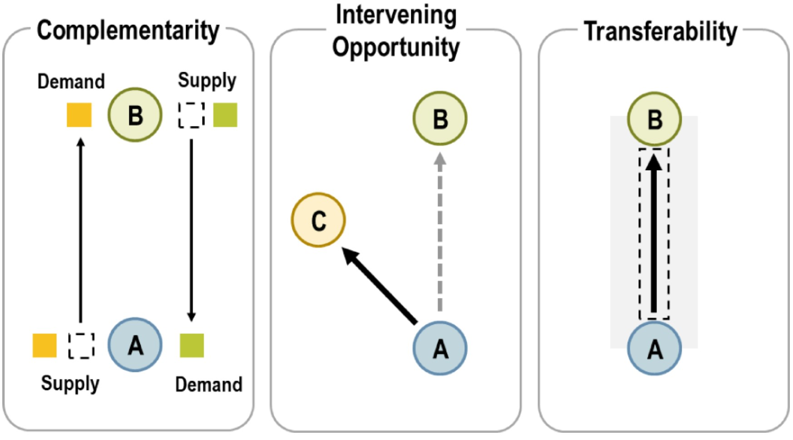
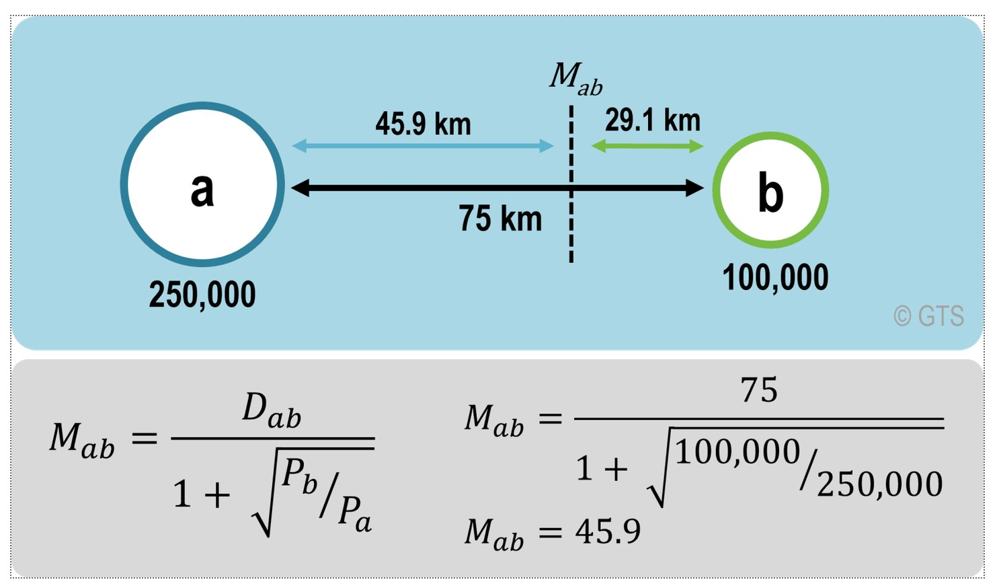
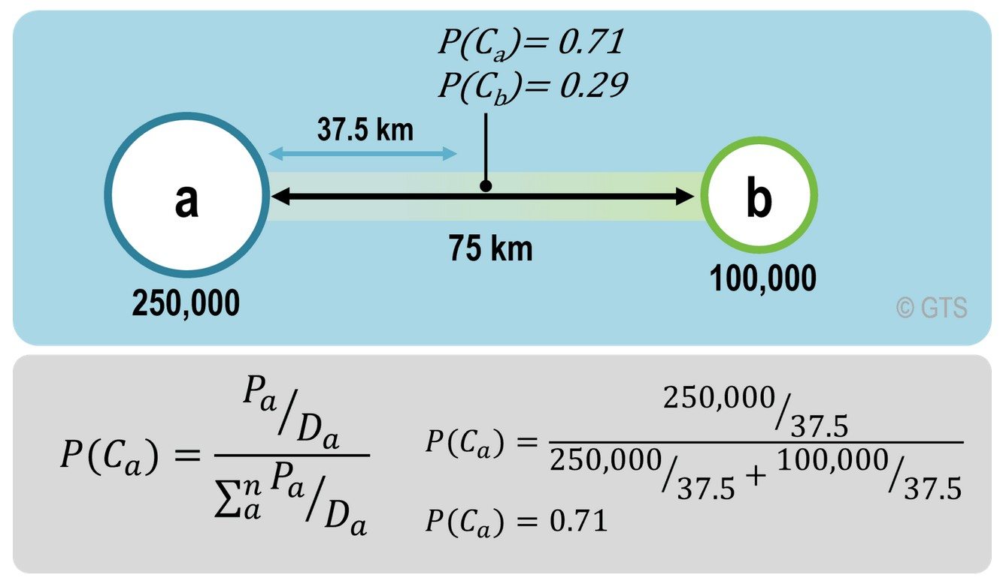
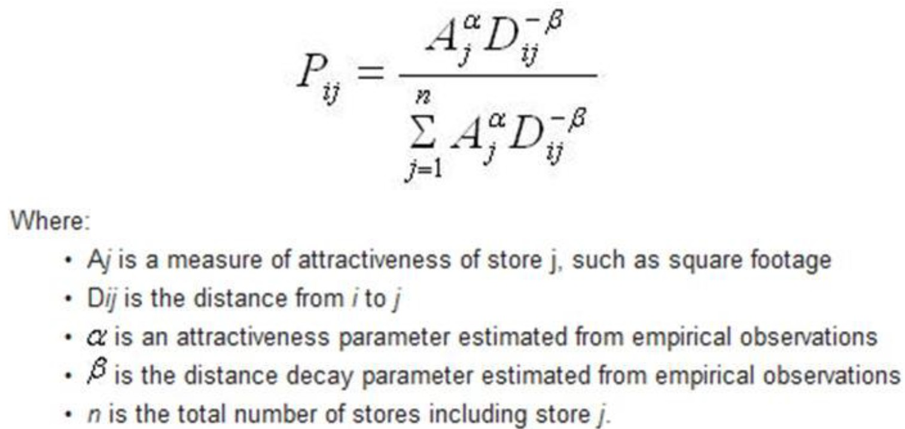
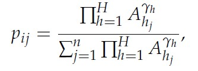

## Content

- Geospatial Analytics for Business Geography
- The Huff Model
- The Multiplicative Competitive Interaction (MCI) Model

## Geospatial Analytics for Business Geography

Business geography is the application of geographic analysis, geospatial data, and spatial technology to improve corporate and strategic decision-making.

Key elements of business geography includes but not limited to

- Site Selection: Using spatial data, demographics, and traffic patterns to find the best locations for retail stores, warehouses, or factories.
- Market Analysis: Dividing and targeting consumer bases by region, city, climate, or urban versus rural settings (geographic segmentation).
- Supply Chain & Logistics: Tracking the movement of raw materials, manufacturing hubs, and distribution routes across local and global networks.
- Risk & Environmental Assessment: Evaluating regional vulnerabilities like natural disasters, resource scarcity (such as water stress), or regulatory changes.
- Economic Base & Location Quotient: Measuring whether a local economy or industry exports goods outside its region or only serves internal demand.


------------------------------------------------------------------------

### Market Area Analysis

A market area analysis is a structured evaluation of the geographic and demographic boundaries from which a business draws its customers, designed to assess demand, competition, and growth potential.



::: notes
- **Complementarity**. There must be a supply and a demand between the interacting locations. A residential zone is complementary to an employment zone because the first is supplying workers while the second is supplying jobs. The same can be said concerning the complementarity between a store and its customers and between an industry and its suppliers (movements of freight). An economic system is based on a large array of complementary activities.
- **Intervening opportunity (lack of)**. Refers to a location that may offer a better alternative as a point of origin or as a point of destination. For instance, in order to have an interaction of a customer to a store, there must not be a closer store that offers a similar array of goods. Otherwise, the customer will likely patronize the closer store and the initial interaction will not take place.
- **Transferability**. Mobility must be supported by transport infrastructures, implying that the origin and the destination must be linked. Costs to overcome distance must not be higher than the benefits of the related interaction, even if there are complementarity and no alternative opportunity.
:::

------------------------------------------------------------------------

## The Origin of Retail Trade Area: Reilly's Law

Reilly’s law of retail gravitation (1931) aims to find a point of indifference between two locations, so that the trading area of each can be determined. This point is assumed to be a function of the distance between two locations pondered by their respective size (population often used for this purpose). A location can thus be more attractive than the other.

::: columns
::: {.column width="50%"}

:::

::: {.column width="50%"}
In the figure, two locations are 75 km apart. According to the Hotelling principle, the point of indifference should be halfway in between (37.5 km). However, since location A has a larger population (more weight), it is assumed to draw more customers. Under such circumstances, the point of indifference is 45.9 km away from location A.
:::
:::


## Huff Model

- Huff model is a retail trade area analysis tool commonly used by analysts and practitioners that **estimates the probability of a consumer visiting a specific store** by considering the store's attractiveness and the distance to it, relative to competing stores.
- It uses a formula where the likelihood of patronage is proportional to the store's attractiveness (e.g., size) and inversely proportional to the distance from the consumer, which decays at a rate determined by a distance exponent.
- Essentially, it helps businesses predict sales potential and determine market areas by calculating a site's attractiveness compared to its competitors.

------------------------------------------------------------------------

### Huff Model: Visual explanation

Huff’s retail model (1963) assumes that customers have a choice to patronize a location in view of other alternatives. Thus, a market area is expressed as a continuous probabilities line, unless there are no other alternative locations. The indifference point becomes the point of equal probability that a customer will patronize one location or another.

::: columns
::: {.column width = "50%"}

:::

::: {.column width = "50%"}
In the figure, a customer has a greater chance (0.71) to patronize location A at the midpoint than location B (0.29). The advantage of Huff’s retail model is that it leaves room for customer choice.
:::
:::

------------------------------------------------------------------------

### The Utility function

:::: columns
::: {.column width="65%"}
The basis of the Huff Model is the following multiplicative utility function with two explanatory variables representing two determinants of store choice (Huff and Batsell, 1975):

$$
U_{ij} = A^⍺_jd^{-𝜆}_{ij}
$$

where:

- $U_{ij}$ is the utility of the supply location $j$ for the customers at origin $i$,

- $A_j$ reflects the attraction of supply location $j$, and

- $d_{ij}$ contains the transport costs customers from $i$ have to take to reach $j$.

  The exponents ⍺ and 𝜆 are weighting parameters.
:::
::::

------------------------------------------------------------------------

### Huff Model: The interaction probability

:::: columns
::: {.column width="65%"}
{width="1009"}

These probabilites can be interpreted as market shares of location $j$ in origin $i$, what can be called **local market shares**. These shares implicitly represent a final state of consumer preference patterns in a spatial equilibrium (Huff and Batsell, 1975).
:::
::::


------------------------------------------------------------------------

### Market Share Analysis:

:::: columns
::: {.column width="50%"}
The **expected customer/expenditure flows** from $i$ to $j$ are estimated by multiplying the local market shares with the local market potential (Huff, 1962):

$$
E_{ij} = p_{ij}C_i,
$$

where

- $E_{ij}$ is the number of expected customer/purchasing power flows from origin $i$ to location $j$, and

- $C_i$ is the total market potential (number of potential customers or purchasing power) in $i$.
:::
::::

------------------------------------------------------------------------

### Market Share Analysis:

::::: columns
::: {.column width="50%"}
The **total sales of each store** in the study area can be determine by summing the expected expenditures from each geographical area for all stores. That is

$$
T_j = \sum_{i=1}^{m} E_{ij}
$$ where $T_j$ is the market area of $j$ containing $m$ submarkets, normally measured in persons or money.
:::

::: {.column width="50%"}
The **market share** of each store within the study area is each store's total expected sales divided by the total scales of all stores.

$$
M_j = T_j / \sum_{j=1}^{m} T_j
$$
:::
:::::

## The Multiplicative Competitive Interaction (MCI) Model

The fundamental theorem behind market share models is the following simple relationship between the competitors’ characteristics and their market shares (Cooper and Nakanishi, 2010):

$$
MS_j =A_j/ \sum_{j=1}^{n} Aj,
$$

where $MS_j$ is the market share of competitor $j$ and $A_j$ is the attraction of $j$. This leads to two characteristics of market shares which are summarized as logical-consistency requirements for market shares: $0 < MS_j < 1$, and $\sum_{j=1}^{n} MS_j = 1$, respectively (Cooper and Nakanishi, 2010).

------------------------------------------------------------------------

### The MCI model

- The MCI Model is explicitly formulated to regard a market which is segmented into $i$ submarkets $(i = 1, ...,m)$ and which is served by $j$ suppliers $(j = 1, ..., n)$.

- The attraction function is multiplicative and consists of $h (h = 1, ..., H)$ explanatory variables which are weighted exponentially to reflect their sensitivity (Nakanishi and Cooper, 1974):

{fig-align="center"}

where:

- $p_{ij}$ is the probability that the customers from submarket $i$ choose supplier $j$,

- $A_{h_j}$ is the value of the h-th variable describing the object $j$,

- $𝛄h$ is the weighting parameter for the sensitivity of $p_ij$ with respect to the variable $h$.

```{r}
#| echo: false
#| eval: false
renderthis::to_pdf(
  from = "https://is415-ay2022-23t2.netlify.app/lesson/lesson11/lesson11-sim.html",
  to = "D://IS415_AY2022-23T2/02-Lesson/Lesson11.pdf"
)
```
